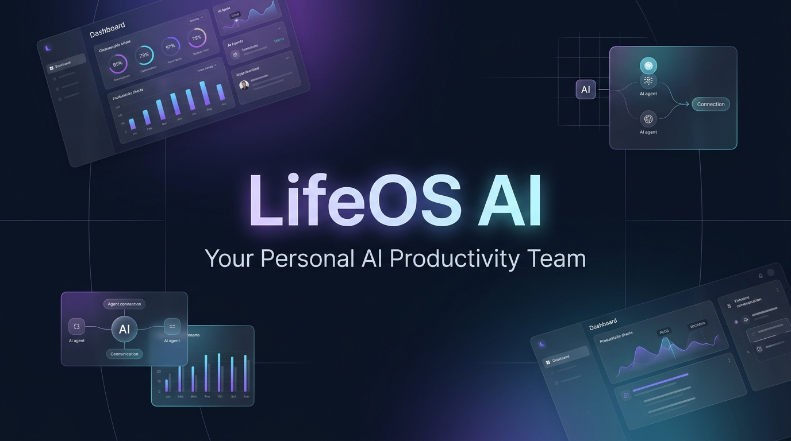
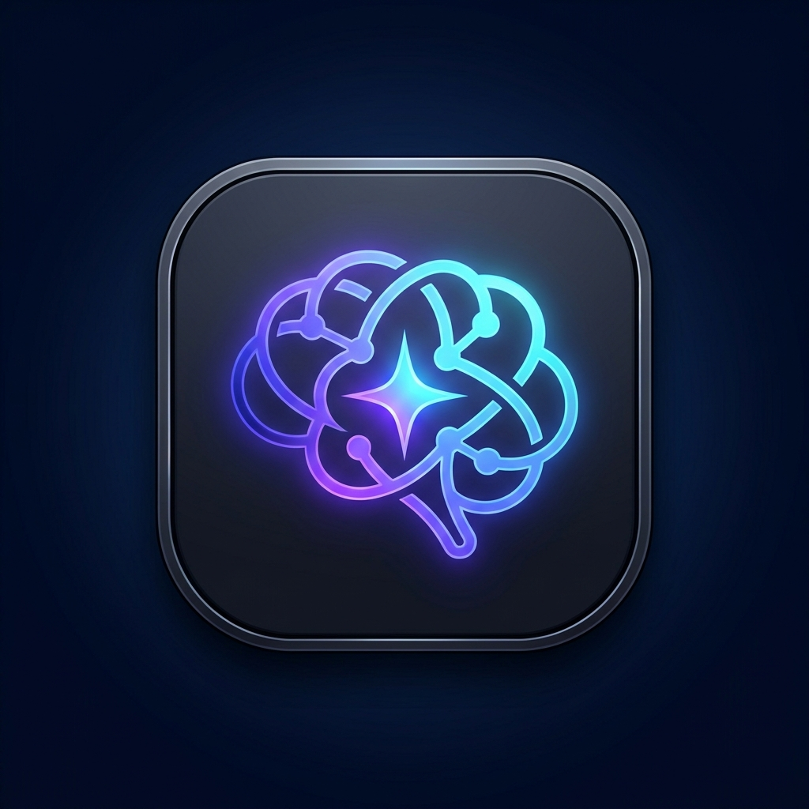
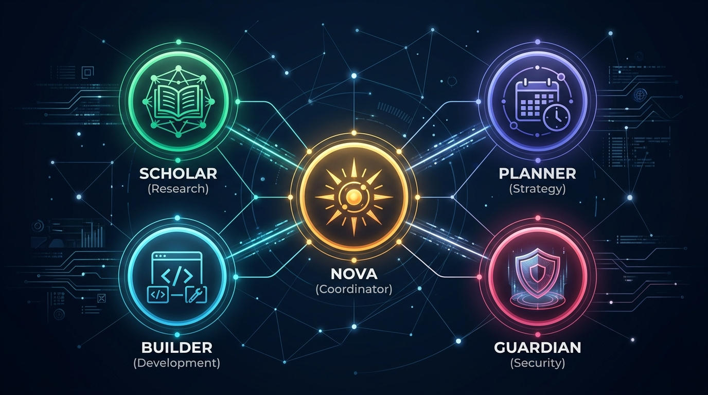
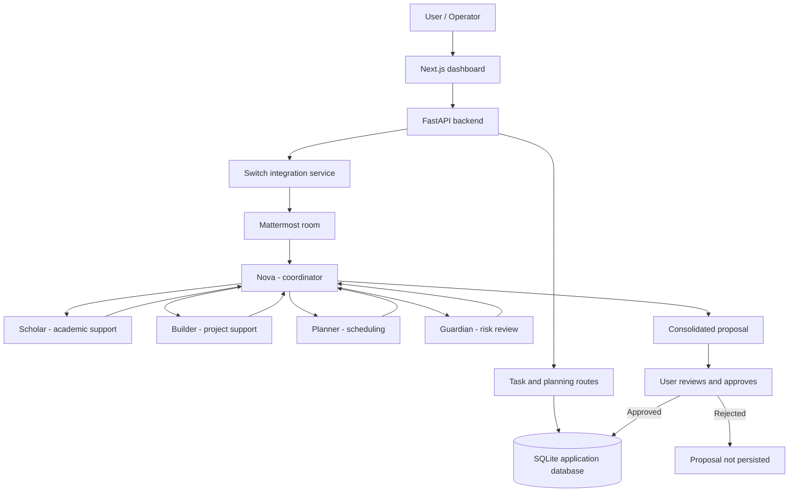
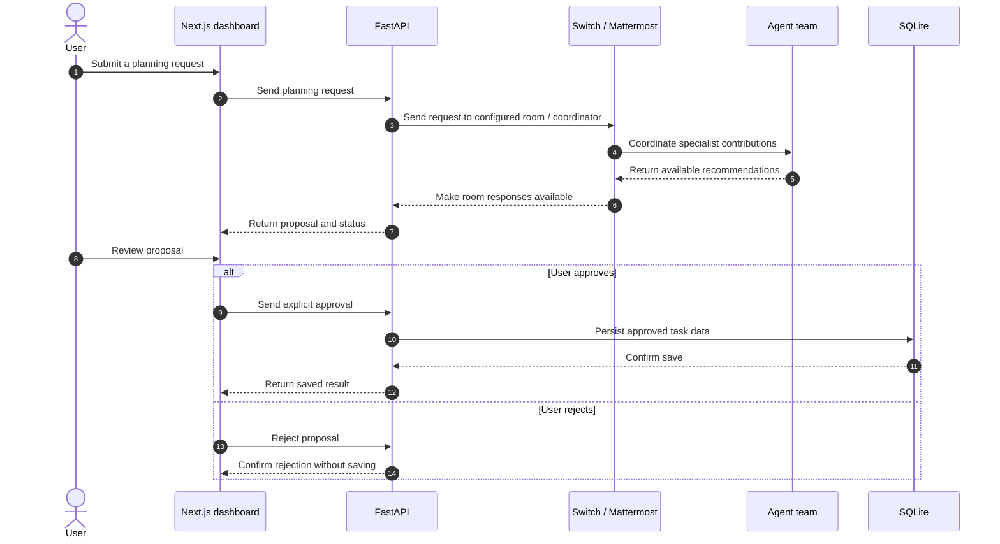

<div align="center">



<br/><br/>



# LifeOS AI
### Autonomous Productivity Platform & Multi-Agent Collaboration Engine

[](https://fastapi.tiangolo.com/)
[](https://nextjs.org/)
[](https://www.typescriptlang.org/)
[](https://www.python.org/)
[](https://tailwindcss.com/)
[](https://sqlite.org/)

<p align="center">
  <b>A personal productivity platform combining task management with a collaborative team of specialized AI agents, with human approval for proposed plans.</b>
</p>

[Key Features](#key-features) • [AI Team](#meet-the-ai-team) • [System Architecture](#system-architecture) • [Getting Started](#getting-started) • [API Documentation](#api-documentation) • [Testing](#testing)

---

</div>

## 📌 Overview & Problem Statement

Students and busy individuals often manage studies, projects, deadlines, and personal goals across disconnected tools. Planning those responsibilities takes time, and a single general-purpose assistant may not provide the focused perspectives needed for scheduling, technical work, research, and workload review.

**LifeOS AI** brings task management and specialized AI assistance into one workspace:

1. **Specialized roles:** Five agents focus on coordination, academic work, software projects, scheduling, and risk review.
2. **Shared collaboration:** Agents can collaborate in the Switch/Mattermost room `#lifeos-planning`.
3. **Human oversight:** Proposed plans are presented for review; approval is required before supported approval endpoints persist them to SQLite.

---

## ⚡ Key Features

- 🧠 **Planning workflow:** Submit a goal and collect a consolidated plan from the agent team through the configured Switch workflow.
- 🎯 **Task management:** Create, list, update, and delete tasks through the FastAPI backend.
- 👥 **Agent collaboration:** Coordinate Nova, Scholar, Builder, Planner, and Guardian in a shared Mattermost room.
- 🛡️ **Workload review:** Guardian can review schedules for overload, missing breaks, and dependencies.
- ⚡ **Connection health:** Check Switch/Mattermost availability and show useful errors when the local service is unavailable.
- 💾 **Persistence and approval:** Store application tasks in SQLite; planning approval endpoints require an explicit user action.
- 🧩 **Graceful local operation:** The app can explain how to restore the local Switch services when Docker or the daemon is unavailable.

---

## 👥 Meet the AI Team

<div align="center">
  
</div>

<br/>

| Agent | Role | Specialization & Focus | Room Handle |
| :--- | :--- | :--- | :--- |
| **Nova** | **Central Coordinator** | Breaks down requests, coordinates specialist hand-offs, and compiles proposals. | `@nova-anant` |
| **Scholar** | **Academic Assistant** | Learning plans, DSA practice, and research notes. | `@scholar-anant` |
| **Builder** | **Project Specialist** | Technical architecture, data schemas, API contracts, and implementation plans. | `@builder-anant` |
| **Planner** | **Scheduling Specialist** | Duration estimates, workload balance, and time-blocked schedules. | `@planner-anant` |
| **Guardian** | **Workload & Risk Reviewer** | Reviews cognitive load, breaks, dependencies, and blockers. | `@guardian-anant` |

---

## 🏗️ System Architecture

The diagram below describes the intended application and local agent setup. Actual live agent availability depends on the local Switch services and configured credentials.



---

## 🔄 Agent Collaboration Workflow



---

## 💻 Technology Stack

| Layer | Technologies | Role in LifeOS AI |
| :--- | :--- | :--- |
| **Frontend** | **Next.js, React, TypeScript** | Responsive dashboard and interactive task views. |
| **Styling & UI** | **Tailwind CSS, Lucide React** | Styling, layout, and icons. |
| **Backend** | **Python, FastAPI, Uvicorn, Pydantic** | REST API, validation, and application logic. |
| **Database** | **SQLite, SQLAlchemy** | Persistence for LifeOS tasks and related application data. |
| **Multi-Agent Runtime** | **Switch Console, Antigravity CLI, ACP, Mattermost** | Local agent management and shared agent communication. |
| **Infrastructure** | **Docker, PostgreSQL** | Local Switch/Mattermost services. |
| **Testing** | **Pytest** | Automated backend tests. |

---

## 🚀 Getting Started

### Prerequisites

- Python 3.11+
- Node.js and npm
- Docker Desktop (for the local Switch services)
- Switch Console with the required agents configured (for agent workflows)

### 1. Clone the Repository

```bash
git clone https://github.com/sanant456/lifeos-ai.git
cd lifeos-ai
```

### 2. Backend Setup

```bash
cd backend

python3 -m venv venv
source venv/bin/activate
pip install -r requirements.txt
```

If the repository includes `.env.example`, copy it and fill in your own local values:

```bash
cp .env.example .env
```

Do not commit your `.env` file or share its secrets. Use the variable names documented in the example file and the backend configuration.

Start the FastAPI server:

```bash
uvicorn app.main:app --reload --port 8000
```

Backend: `http://127.0.0.1:8000`

### 3. Frontend Setup

Open a second terminal:

```bash
cd frontend
npm install
npm run dev
```

Open `http://localhost:3000` in your browser.

---

## 📖 API Documentation

When the backend is running, FastAPI provides interactive documentation:

- **Swagger UI:** [http://127.0.0.1:8000/docs](http://127.0.0.1:8000/docs)
- **ReDoc:** [http://127.0.0.1:8000/redoc](http://127.0.0.1:8000/redoc)

### Key Endpoints

| Method | Endpoint | Description |
| :--- | :--- | :--- |
| `GET` | `/health` | Basic application health check. |
| `GET` | `/api/tasks` | List tasks. |
| `POST` | `/api/tasks` | Create a task. |
| `PATCH` | `/api/tasks/{id}` | Update a task. |
| `DELETE` | `/api/tasks/{id}` | Delete a task. |
| `GET` | `/api/planning/health` | Check Switch/Mattermost connectivity. |
| `GET` | `/api/planning/session` | Retrieve planning session information. |
| `POST` | `/api/planning/submit` | Submit a planning request. |
| `POST` | `/api/planning/approve` | Persist a reviewed planning proposal after explicit approval. |
| `POST` | `/api/tasks/analyze` | Request task analysis. |
| `POST` | `/api/tasks/analyze/approve` | Save an analyzed task after explicit approval. |

Check the live Swagger documentation for the exact request schemas and available endpoints in your checked-out version.

---

## 🧪 Testing

Run backend tests from the backend directory:

```bash
cd backend
source venv/bin/activate
python -m pytest tests/ -v
```

Run a frontend production build:

```bash
cd frontend
npm run build
```

Test results can vary with code changes and environment. Run the commands above to verify the current checkout.

---

## 📁 Project Folder Structure

```text
lifeos-ai/
├── README.md
├── docs/
│   └── assets/
│       ├── lifeos-banner.png
│       ├── lifeos-logo.png
│       └── agent-team.png
├── backend/
│   ├── .env.example
│   ├── requirements.txt
│   ├── app/
│   │   ├── main.py
│   │   ├── database.py
│   │   ├── models.py
│   │   ├── schemas.py
│   │   ├── routes.py
│   │   └── switch_service.py
│   └── tests/
└── frontend/
    ├── package.json
    └── src/
        ├── app/
        ├── components/
        ├── lib/
        └── types/
```

---

## ⚠️ Known Limitations & Future Roadmap

### Current Limitations

1. **Local service dependency:** Live agent communication depends on the local Switch runtime, Mattermost, Docker, and valid local configuration.
2. **Agent response latency:** Multi-agent deliberation may take time because several agents need to process and respond.
3. **Polling:** The current workflow uses polling to retrieve room updates; event-driven updates could improve responsiveness.

### Future Roadmap

- [ ] WebSocket or event-based updates for agent progress.
- [ ] Calendar integration for approved schedules.
- [ ] More project and milestone management features.
- [ ] Additional resilience and deployment options for remote use.

---

## 🤝 Contributing

Contributions are welcome!

1. Fork the repository.
2. Create a feature branch: `git checkout -b feature/your-feature`.
3. Run backend tests and the frontend production build.
4. Commit your changes.
5. Push your branch and open a Pull Request.

---

## 📄 License

Add a license file before describing this project as distributed under a specific license.

---

<div align="center">
  <sub>Built for the Google Antigravity &amp; Switch Multi-Agent Hackathon.</sub>
</div>
